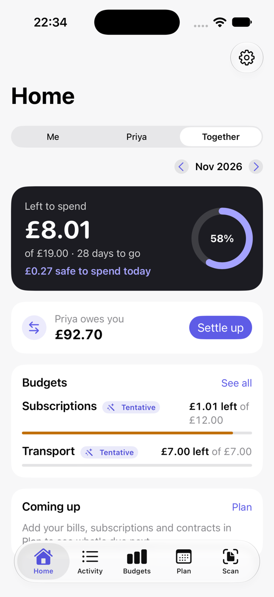
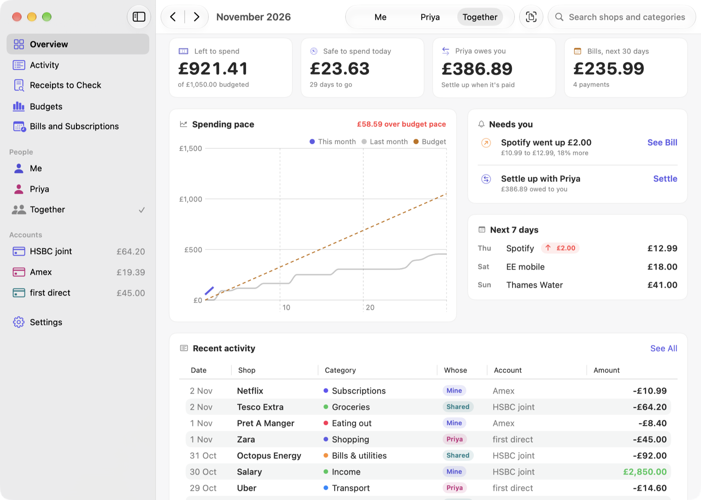

# Getting started

Duo Budget keeps your budget, bank statements and receipts in one place, for you alone or for you and a partner. It runs on iPhone and Mac (iOS 26 and macOS 26 or later), and everything stays on your devices and in end-to-end encrypted iCloud.

## 1. First setup

The first time you open the app, a welcome screen asks three things:

1. **Your currency.** All amounts are shown in it. You can change it later in Settings › Money.
2. **Who's budgeting.** Enter your name. If you budget with a partner, enter their name too; leave it empty if it's just you. You can invite them later (see [Budgeting as a couple](06-couples.md)).
3. **Your first statement.** Import a CSV, OFX, QFX, QIF or PDF statement from your bank's website, or skip this and do it later.

That's all you need. The app sorts your payments into categories by itself and suggests budgets from your spending.

## 2. The main screens

| Screen | iPhone | Mac sidebar | What it's for |
| --- | --- | --- | --- |
| Home | Home tab | Overview | This month at a glance: safe to spend today, budgets, coming up, goals |
| To Check | Home › More places | To Check | New payments that need a category and receipts to approve |
| Activity | Activity tab | Activity | Every payment, with search and filters |
| Budgets | Budgets tab | Budgets | Spending against each category's budget |
| Plan | Plan tab | Bills and Subscriptions | Subscriptions, contracts, goals, trips, returns, money owed back |
| Reports | Home › More places | Reports | Cash flow, trends, shops and your year |
| Net worth | Home › More places | Net worth | Savings, pensions, property and debts |
| Scan | Scan button | Scan | Read a receipt |
| Settings | Settings | Settings | Everything you can switch on or off |

On the Mac, the Overview is a "command centre" with the month, the people in your household and recent activity side by side. Press **⌘K** to jump to any screen or find a payment.

## 3. Turn on iCloud sync

Settings › iCloud › **Sync with iCloud** keeps your iPhone and Mac the same. It uses your own iCloud account, and every item is end-to-end encrypted, so Apple can't read it. A small cloud symbol on Home (iPhone) or in the toolbar (Mac) shows whether sync is up to date; tap it for details.

Sign in to the same Apple ID on both devices and turn sync on on each one. The first sync can take a minute.

## 4. Lock the app (optional)

Settings › Privacy › **Lock with Face ID** (or Touch ID, or your passcode) asks to unlock each time the app opens. Reminders on the Lock Screen then stay generic.

## 5. Set your payday (optional)

If you're paid on, say, the 25th, Settings › Payday lets you budget from one pay day to the next instead of by calendar month.

## What next

- [Import your statements](02-importing-statements.md) from each bank account and card.
- [Scan your receipts](03-receipts.md) as you shop.
- [Check your budgets](04-budgets.md) once a few weeks of payments are in.
