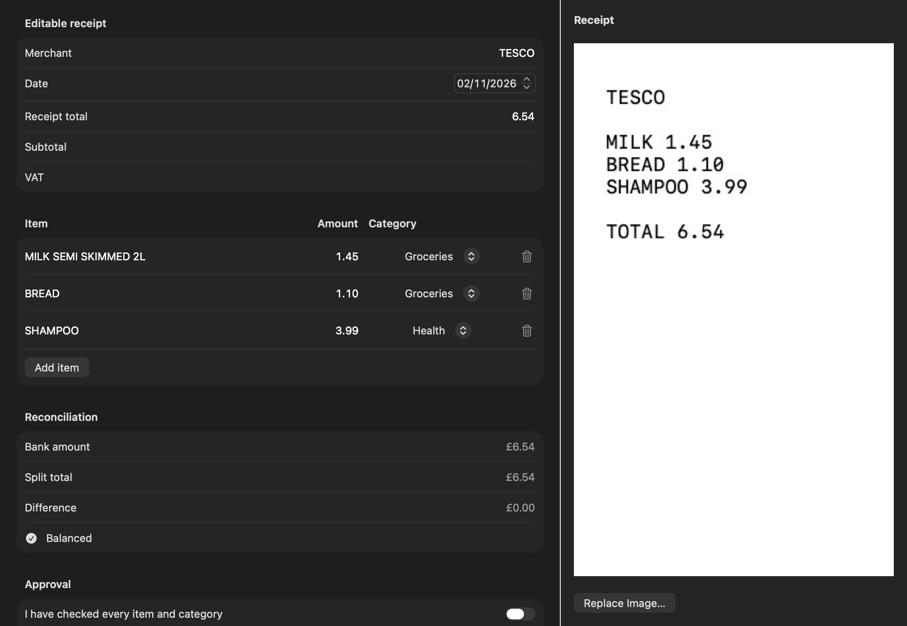

# Receipts

Scan a receipt and Duo Budget reads the shop, date, total, card and each item, then splits the matching bank payment into categories. Receipts are read on the device with Apple Vision and Apple Intelligence; nothing is uploaded.

## Adding a receipt

- **iPhone:** tap **Scan** and take a photo, or choose one from Photos. You can also share a photo or PDF receipt (for example from Mail) to **Duo Budget**, or use the Scan button in Control Centre (see [Widgets, Siri and Ask your budget](09-widgets-siri-ask.md)).
- **Mac:** choose Scan › Choose Receipt Image…, drop a photo anywhere on the Scan page, or use File › Import from iPhone to take one with your iPhone camera.

## Matching the receipt to a payment

A receipt usually arrives before the bank statement, so it waits under **Waiting for payment**.

When you import a statement, the receipt is matched by itself only if there's **exactly one payment with the same total, dated from 2 days before to 7 days after the receipt**. If the receipt shows a card ending, only that card's account is searched. Otherwise it keeps waiting and shows suggestions ("Is it one of these payments?"), and you can pick the payment yourself.

If the receipt was paid in cash, or the payment isn't on any statement, choose **Not on my statement yet. Save for later**.

If a bank statement was read as a receipt by mistake, choose **This is a statement: import it instead**.

## Checking and approving

Matched receipts go to **To Check**. The check screen shows the items on the left and the receipt photo on the right. Check each line's description, category and amount, and the date, subtotal and VAT.

Nothing is changed until you approve. The split is only applied when every line has a description, a category and a positive amount, and the items add up to the bank payment (within half a penny).

Settings › Receipts › **Smart receipt reading** uses Apple Intelligence on the device to tidy up item names and categories.

## Returns and warranties

On the check screen, or in a payment's details, you can add a **last day to return** (quick picks from 14 to 90 days) and a **warranty end** (1 to 5 years). You can also add them by hand in Plan › Returns and warranties.

- The receipt photo is kept, so you have it if you need to return something.
- A return closing within 3 days shows in red, and within 7 days in amber.
- With reminders on, you're told 3 days before the last day to return and 30 days before a warranty ends.
- Mark an item **returned** once it's gone back.
