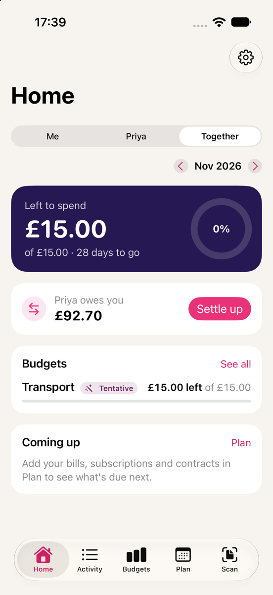

# Budgeting as a couple

Duo Budget works for one person by default. Add your partner's name in **Settings › Couple** to turn on the couple features, then invite them to share a household.

## Inviting your partner

Both of you need Duo Budget, and iCloud sync turned on (Settings › iCloud).

1. Go to Settings › Partner › **Invite with a QR code or link**.
2. Enter the email address or phone number your partner signs in to iCloud with (with country code, like +44). Only that Apple ID can open the invitation.
3. Your partner opens the Camera on their iPhone and points it at the QR code, or opens the link you send by AirDrop or copy. Duo Budget opens and joins the household.

The app says "Joining…" and then tells you whether it worked. It can take a minute for items to appear.

**Tip:** if an invitation sent through Messages doesn't work, use the QR code: it's usually because the message went to a number or address that isn't their Apple ID.

## Shared by default, private when you choose

Everything is **shared** with your partner unless you mark it **Private**. You can mark a payment, an account (its payments become private too), a contract, a goal or a trip private. Private items stay on your own devices.

Marking something private hides it from then on; copies already shared stay with your partner, because iCloud can't take them back.

Shared items stay end-to-end encrypted: only the two of you can read them.

## Whose money

Every payment, receipt split and receipt item can be **Mine**, **Partner** or **Shared**. If you don't set it by hand, the app decides in this order:

1. what you set on the payment (or the split or receipt item),
2. a merchant rule ("Netflix is mine"),
3. a category rule ("Groceries are shared"),
4. the default owner.

Set these in Settings › Couple › **Whose money rules**.

## The Me / Partner / Together switch

Once your partner's name is set, Home, Budgets and Reports have a switch:

- **Me**: your own spending plus your share of shared costs.
- **Partner**: the same for your partner.
- **Together**: everything.

Shared costs are split 50/50 by default. You can change your share, or split by income (for example 3,000 and 2,000 gives 60/40).

## Who owes whom

Whoever paid for something shared is owed the other person's share. Settings › Couple › **Who owes whom** shows the balance ("Sam owes you"). When the money has actually been sent, tap **Mark as Settled Up** and the balance goes back to zero.

## Leaving or stopping

The household owner can **Stop Sharing**; your partner can **Leave Household**. Your own data stays on your devices. Anything your partner changes or deletes can be put back from **Recently changed** for 30 days.
