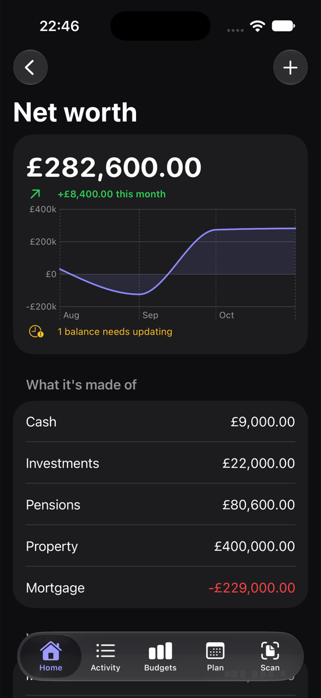

# Reports and net worth

## Reports

Reports (Home › More places on iPhone, or the Mac sidebar) show:

- **Cash flow**: money in and out each month.
- **Trends**: how each category changes over the months (the six biggest are shown).
- **Shops**: where the money in each category went.
- **Whose spending**: you, your partner and shared, if you budget as a couple.
- **Your year**: the year at a glance, with the biggest purchase and the categories over budget.
- **Net worth**: how your savings, pensions and property change.

Use **Export report** to save a report as **PDF** or **CSV**. Settings › Export also has **Export All Transactions (CSV)** and a PDF report for the month.

## Net worth

Net worth adds up what you own and owe. Tap **Add Account** to add:

- savings and investments,
- pensions (for example "Workplace pension"),
- your home and other property,
- a mortgage or other loans (enter what you owe as a positive number).

Update the values now and then to see your net worth change over time. For a mortgage, add the rate and monthly payment to see when it will be paid off.

Pensions and property **count in the total**, but reports break them out separately, so you can see the money you can actually reach.

Each account can be yours, your partner's or shared, and can be marked private.
