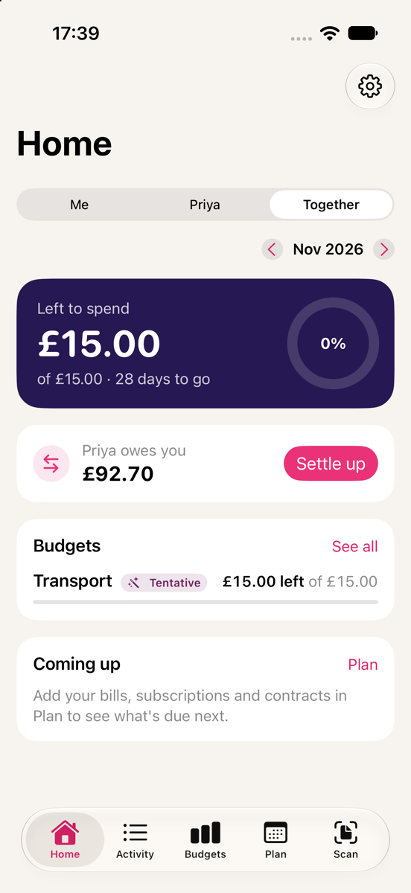

On its own, Duo Budget works for one person. To use it as a couple, add your partner's name in Settings > Couple, then invite them to join your household.

## Inviting your partner

You'll both need the app, with iCloud sync turned on (Settings > iCloud).

1. Go to Settings > Partner > Invite with a QR code or link.
2. Type in the email address or phone number your partner uses for their Apple ID. Include the country code for a phone number, like +44. Only that Apple ID can open the invitation.
3. Your partner points their iPhone camera at the QR code, or opens the link you send them by AirDrop or message. Duo Budget opens and joins the household.

You'll see "Joining…" and then a message saying whether it worked. Their items can take a minute to show up.

If an invite sent through Messages doesn't seem to do anything, try the QR code instead. It usually means the message went to a number or email that isn't their Apple ID.

## Shared unless you say otherwise

Everything is shared with your partner unless you mark it Private. You can make a payment, an account, a contract, a goal or a trip private. Making an account private makes its payments private too. Private things stay on your own devices.

Marking something private only hides it from then on. If your partner already had a copy, it stays on their devices, because iCloud can't take it back.

Shared items are still encrypted end to end, so only the two of you can read them.

## Whose money is it?

Every payment, receipt split and receipt item can be marked Mine, Partner or Shared. If you don't set it yourself, the app goes through these in order:

1. anything set by hand on the payment, split or item
2. a shop rule, like "Netflix is mine"
3. a category rule, like "Groceries are shared"
4. the default

You'll find the rules in Settings > Couple > Whose money rules.

## Me, Partner and Together

Once your partner's name is set, Home, Budgets and Reports get a switch at the top.

- Me shows your own spending plus your share of shared costs.
- Partner shows the same for your partner.
- Together shows everything.

Shared costs are split 50/50 to start with. You can change the split, or base it on what you each earn. If one of you earns 3,000 and the other 2,000, that's 60/40.

## Who owes whom

If one of you pays for something shared, the other owes their share. Settings > Couple > Who owes whom keeps a running total ("Sam owes you £42.10"). Once the money has actually changed hands, tap Mark as Settled Up and it goes back to zero.

## Stopping sharing

The person who set up the household can choose Stop Sharing, and the partner can choose Leave Household. Your own data stays on your devices either way. If your partner changes or deletes something, you can put it back from Recently changed for up to 30 days.
