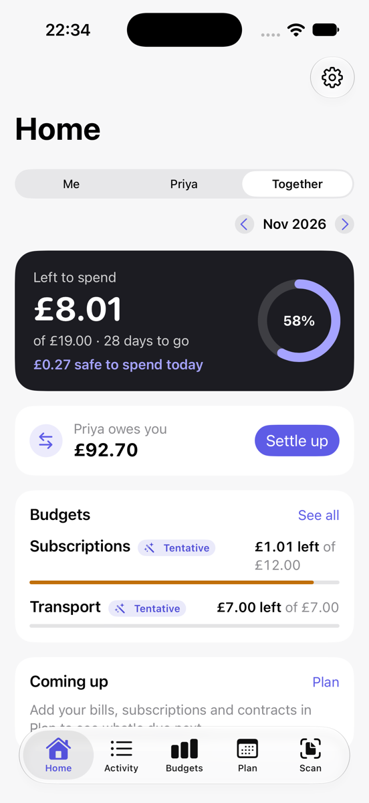
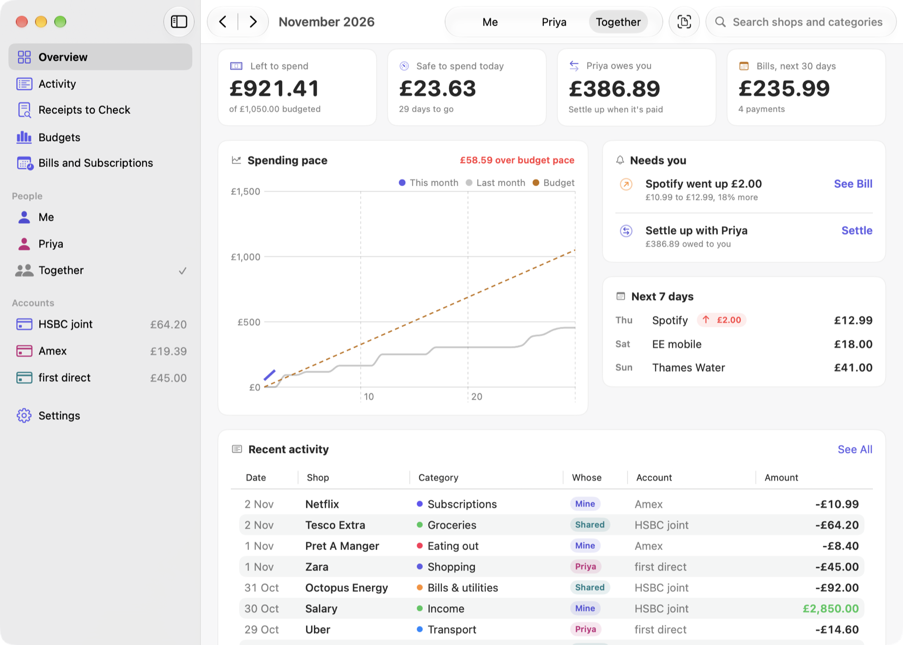

You need an iPhone with iOS 26 or a Mac with macOS 26, or later.

## First setup

When you first open the app it asks three things.

1. Your currency. You can change it later in Settings > Money.
2. Your name, and your partner's name if you're budgeting together. Leave the partner's name empty if it's just you. You can invite your partner later (see [Budgeting as a couple](Budgeting-as-a-couple)).
3. A first bank statement. Download one from your bank's website as CSV, OFX, QFX, QIF or PDF and pick it here. You can skip this and do it later.

After that, the app sorts your payments into categories and suggests budgets based on what you spent.

## Finding your way around

| Screen | Where on iPhone | Where on Mac | What it's for |
| --- | --- | --- | --- |
| Home | Home tab | Overview | This month: what's safe to spend today, budgets, what's coming up, goals |
| To Check | Home, under More places | To Check | New payments without a category, and receipts to approve |
| Activity | Activity tab | Activity | Every payment, with search and filters |
| Budgets | Budgets tab | Budgets | Spending against each category's limit |
| Plan | Plan tab | Bills and Subscriptions | Subscriptions, contracts, goals, trips, returns, money owed back |
| Reports | Home, under More places | Reports | Cash flow, trends, shops, your year |
| Net worth | Home, under More places | Net worth | Savings, pensions, property and debts |
| Scan | Scan button | Scan | Reading a receipt |

On the Mac, the Overview puts the month, the people in your household and recent payments side by side. Press ⌘K to jump to a screen or search for a payment.

## Sync between iPhone and Mac

Turn on Settings > iCloud > Sync with iCloud on each device. Both need to be signed in to the same Apple ID. The first sync can take a minute or two.

Sync uses your own iCloud account and everything is encrypted end to end, so Apple can't read it. The small cloud icon on Home (iPhone) or in the toolbar (Mac) shows whether you're up to date. Tap it to see more.

## Locking the app

If other people use your phone, turn on Settings > Privacy > Lock with Face ID (or Touch ID, or your passcode). The app then asks you to unlock it each time it opens, and reminders on the Lock Screen don't show any details.

## Budgeting from payday

If you're paid on the 25th, say, you can set Settings > Payday so each budget month runs from one payday to the next instead of the 1st to the 31st.

## Next

- [Import statements](Importing-statements) from each of your accounts and cards.
- [Scan receipts](Receipts) when you shop.
- After a few weeks, look at your [budgets](Budgets-and-categories).
