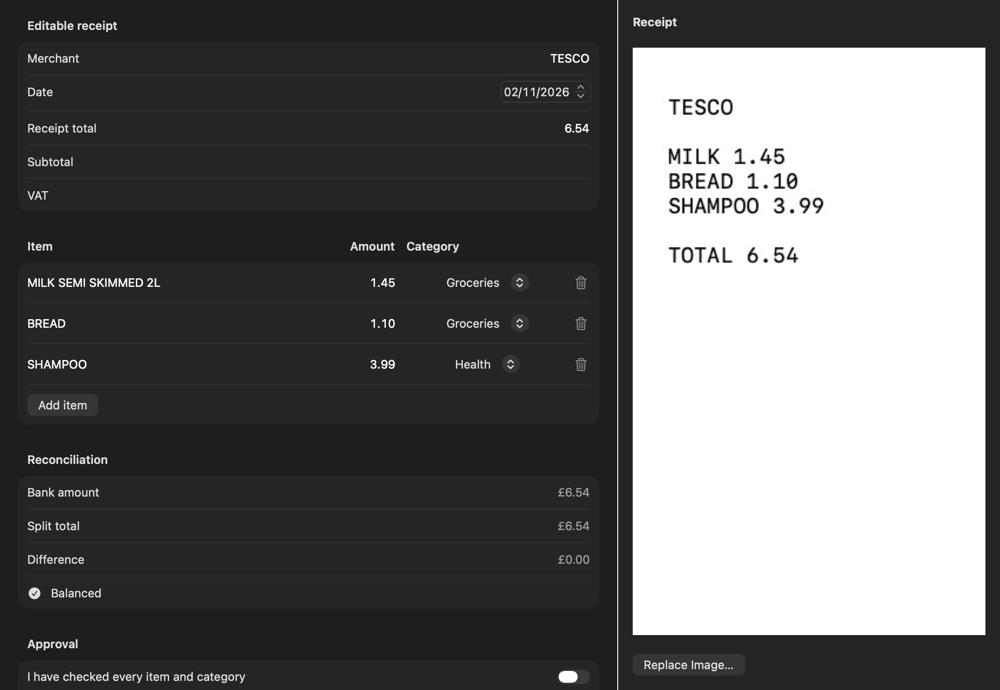

When you scan a receipt, the app reads the shop, date, total, card and each item. It then uses the items to split the matching bank payment into categories. All of this happens on your device and nothing is uploaded.

## Adding a receipt

On iPhone, tap Scan and take a photo, or choose one from Photos. You can also share a photo or PDF to Duo Budget from another app (an emailed receipt in Mail, for example), or use the scan button in Control Centre (see [Widgets, Siri and Ask your budget](Widgets-Siri-and-Ask-your-budget)).

On the Mac, use Scan > Choose Receipt Image…, drop a photo onto the Scan page, or choose File > Import from iPhone to take the photo with your phone's camera.

## How receipts find their payment

Receipts usually arrive before the bank statement does, so a new receipt sits in Waiting for payment.

When you import a statement, the app matches the receipt on its own only if there's exactly one payment with the same total, dated between 2 days before and 7 days after the receipt. If the receipt shows the last digits of a card, it only looks in that card's account. When there's more than one candidate, or none, the receipt keeps waiting and shows the closest payments under "Is it one of these payments?" so you can pick.

Paid in cash, or the payment won't ever show up on a statement? Choose Not on my statement yet. Save for later.

If you scanned a bank statement by accident, choose This is a statement: import it instead.

## Checking and approving

Matched receipts go to To Check. The items are on the left and the photo is on the right, so you can compare them line by line. Fix anything the app misread, including the date, subtotal and VAT.

Nothing changes until you approve. The app only lets you approve when every line has a description, a category and an amount above zero, and the lines add up to the bank payment (to within half a penny).

Settings > Receipts > Smart receipt reading uses Apple Intelligence on the device to clean up item names and pick better categories.

## Returns and warranties

While checking a receipt, or from a payment's details, you can add the last day to return the item (14 to 90 days) and when its warranty ends (1 to 5 years). You can also add these by hand in Plan > Returns and warranties.

- The receipt photo is kept so you have it if you need to take something back.
- A return that closes in the next 3 days is shown in red, and in the next 7 days in amber.
- If reminders are on, you get one 3 days before the last day to return and one 30 days before a warranty ends.
- When you've taken something back, mark it as returned.
