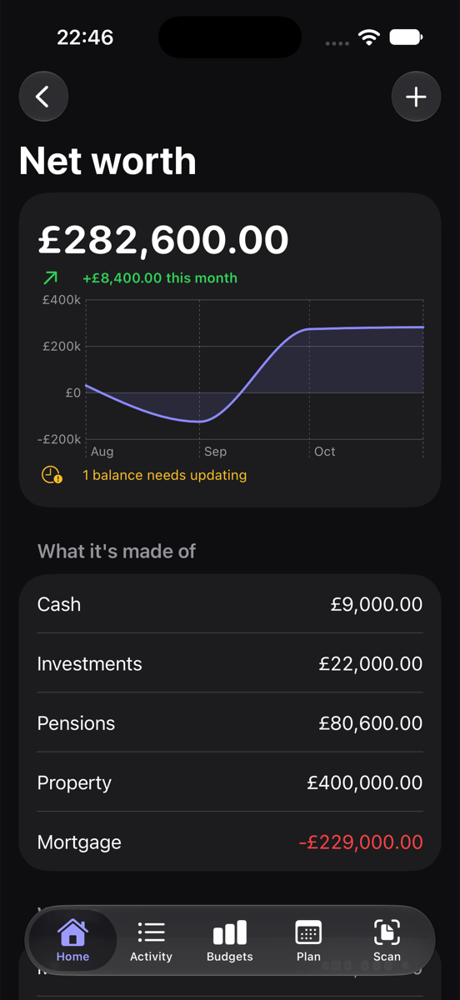

## Reports

Reports is under More places on the iPhone Home screen and in the Mac sidebar. It has:

- Cash flow: money in and out each month
- Trends: how your biggest six categories change over time
- Shops: where the money in each category went
- Whose spending: yours, your partner's and shared, if you budget as a couple
- Your year: the whole year, including your biggest purchase and which categories went over
- Net worth: how your savings, pensions and property change

To save a report, use Export report and pick PDF or CSV. Settings > Export also has Export All Transactions (CSV) and a PDF report for the current month.

## Net worth

Net worth is what you own minus what you owe. Tap Add Account to add any of these:

- savings and investments
- pensions, like a workplace pension
- your home or other property
- a mortgage or other loans (enter the amount you owe as a positive number)

Update the values every so often and you'll see how things change. For a mortgage, add the interest rate and monthly payment and the app works out when it'll be paid off.

Pensions and property are included in the total, but reports list them separately so you can see how much you could actually get at.

Each account can be yours, your partner's or shared, and you can mark any of them private.
